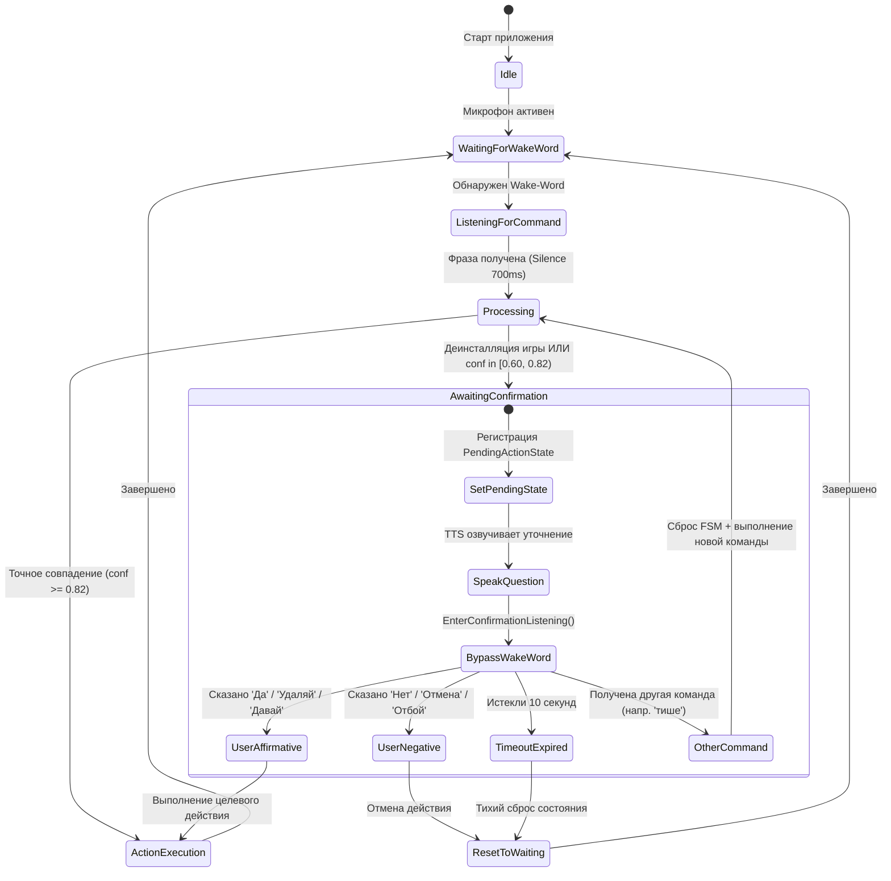

# JARVIS — Техническая карта архитектуры (ARCHITECTURE.md)

Документ предназначен для быстрой контекстной ориентации AI-агента в среде AntiGravity IDE. Содержит схемы пайплайна, порядок диспетчеризации, каталог сервисов, описание FSM-состояний и правила разработки для будущих задач.

---

## 1. High-Level Flow (Пайплайн голосового запроса)

Полный жизненный цикл обработки пользовательского ввода: от снятия звука с аудиокарты до выполнения низкоуровневых Win32-действий и голосового ответа.

```mermaid
flowchart TD
    MIC([Микрофон / NAudio WaveIn]) -->|16kHz 16-bit PCM| VL[VoiceListener]
    
    subgraph VoiceListener_FSM [VoiceListener State Machine]
        VL -->|WaitingForWakeWord| WWF{WakeWordFactory}
        WWF -->|По умолчанию: все имена, включая 'джарвис'| VOSK_WW[VoskGrammarWakeWordDetector / vosk-model-small-ru]
        WWF -.->|Опционально: ONNX KWS| ONNX_WW[OpenWakeWordDetector / ONNX jarvis.onnx]
        
        VOSK_WW -->|Детекция: БЕСШУМНО без бипов| ACL[ListeningForCommand]
        ONNX_WW -->|Детекция: БЕСШУМНО без бипов| ACL
        ACL -->|Поток на vosk-model-ru-0.42| VOSK[Vosk STT Engine]
        VOSK -->|Silence Timeout 700ms| CMD_READY[Команда сформирована]
    end

    CMD_READY --> DUAL_PATH[LlmIntentService: Dual-Path Router]

    subgraph Routing_Engine [Dual-Path Routing Engine]
        DUAL_PATH -->|1. TryFastMatch < 5ms| FAST{Быстрый путь?}
        FAST -->|HIT: Media, Volume, Timer, App, FSM| DIRECT_RESP[JarvisResponse]
        FAST -->|MISS: Free Query / Ambiguous| LLM_CALL[LM Studio API / Qwen2.5]
        LLM_CALL --> DIRECT_RESP
    end

    DIRECT_RESP --> ROUTER[CommandRouter]
    
    subgraph Execution_Layer [Execution & Handlers]
        ROUTER -->|command: volume| VOL_H[VolumeCommandHandler / IAppAudioService / CoreAudioApi]
        ROUTER -->|command: media| MED_H[MediaCommandHandler / IMediaSessionService / GSMTC / Win32]
        ROUTER -->|command: timer| TIM_H[TimerCommandHandler / TimerService]
        ROUTER -->|command: app| APP_H[AppControlCommandHandler / SteamService]
        ROUTER -->|command: system| SYS_H[SystemCommandHandler / Exit]
        ROUTER -->|command: weather| WTH_H[WeatherCommandHandler / WeatherService]
        ROUTER -->|command: hotkey| HTK_H[HotkeyCommandHandler / SendInput]
    end

    DIRECT_RESP -->|reply: text| VFS[IVoiceFeedbackService]
    VFS --> TTS[CompositeVoiceFeedbackService]

    subgraph TTS_Pipeline [Resilient TTS Pipeline (Male & Female Voices)]
        TTS -->|1. Primary (EnableEdgeTts=true)| EDGE[EdgeTtsEngine / ru-RU-DmitryNeural or ru-RU-SvetlanaNeural + 1500ms Connect + 2000ms FirstChunk]
        EDGE -.->|Fast Failover <= 1.6s| SAPI[SystemSpeechTtsEngine / SAPI5: Direct COM Tokens (Aidar / Baya / Kseniya) / Windows SAPI5 (Microsoft Pavel / Microsoft Irina Desktop)]
        TTS -->|Pause / Resume & Confirmation| VL
    end
```

### Пошаговое прохождение запроса:
1. **Захват звука (`VoiceListener.cs`)**: Поток PCM 16 кГц проходит через встроенный **RMS Energy Gate (порог 400–500, по умолчанию 450)**. Кадры с энергией ниже порога классифицируются как тишина/фоновый шум и отбрасываются до передачи в распознаватель, предотвращая галлюцинации модели на дыхании, сопении и шуме комнаты.
2. **Адаптивная детекция активации (БЕЗ ЗВУКОВЫХ СИГНАЛОВ)**:
   - В состоянии `WaitingForWakeWord` фабрика `WakeWordFactory` направляет поток:
     - В `VoskGrammarWakeWordDetector` (малая модель `vosk-model-small-ru` с жесткой грамматикой `["{targetName}", "[unk]"]`, маршалируемой строго как UTF-8 через нативный P/Invoke) по умолчанию для целевого слова «джарвис» и любых кастомных имен.
     - Опционально в `OpenWakeWordDetector` (OnnxRuntime `jarvis.onnx`).
   - **Фильтрация акустической длительности слова (Порог: 150 мс)**: длительность звучания фразы должна составлять **не менее 150 мс** (`minDurationMs = 150`). Одиночные звуковые всплески, чихи, вздохи, кашель и обрывки «джа», «да» длительностью < 150 мс игнорируются.
   - **Строгий токен-матчинг**: целевое слово проверяется строго как изолированный токен через регулярное выражение `(?:\b|\s|^)джарвис(?:\b|\s|$)` и токенную десериализацию, исключая ложные срабатывания на суффиксы и похожие слова («джарвиса», «сюрприз», «рис», «вис»).
   - При обнаружении имени **НЕ ПРОИЗВОДИТСЯ никаких звуковых сигналов (никаких Console.Beep, джинглов или проигрывания звуков)**.
   - Происходит мгновенный бесшумный переход в `ListeningForCommand` (HUD переключается в `Listening`), и поток PCM переключается на полноразмерную акустическую модель `vosk-model-ru-0.42` (~1.5 ГБ) для приема команды.
   - При истечении тишины (700 мс после окончания речи) формируется итоговая строка фразы без дробления слов на паузах.
3. **Dual-Path Диспетчеризация (`LlmIntentService.cs`)**:
   - Сначала вызывается `TryFastMatch(spokenText)` (выполняется строго `< 5 мс`, без сетевых запросов).
   - Системные приложения (`browser`, `notepad`, `calc`, `explorer`, `discord`, `telegram`, `steam`) проверяются **до** обобщенного поиска игр Steam, полностью исключая ложноположительные коллизии (например, «открой браузер» $\to$ «Graveyard Keeper»).
   - Выводятся трейсы маршрутизации: `[Router: FastMatch] Анализ фразы: ...` и `[Router: FastMatch] HIT -> ...` или `[Router: FastMatch] MISS -> Перенаправление в LLM (InterpretAsync)...`.
   - Если совпадение найдено, формируется типизированный `JarvisResponse` с объектом `CommandRequest` и текстом `Reply`.
   - Если быстрое совпадение отсутствует, запрос уходит в `InterpretAsync()` к локальной LLM (LM Studio / OpenAI-compatible API).
4. **Маршрутизация (`CommandRouter.cs`)**:
   - Если в ответе присутствует `CommandRequest`, роутер логирует `[Router: Dispatch] Маршрутизация команды...`, находит зарегистрированный `ICommandHandler` и вызывает `ExecuteAsync()`, после чего логирует `[Router: Result]`.
5. **Голосовой синтез (`IVoiceFeedbackService` / `CompositeVoiceFeedbackService.cs`)**:
   - Все обработчики и пайплайн вызывают единую абстракцию `IVoiceFeedbackService.SpeakAsync(text)`.
   - **Primary**: `EdgeTtsEngine` (онлайн-голоса: мужской `ru-RU-DmitryNeural` и женский `ru-RU-SvetlanaNeural`, базовый таймаут подключения **1500 мс**, жесткий таймаут первого чанка аудиоданных **2000 мс** через `CancellationTokenSource` с немедленным разрывом сокета без повторов, сброс счетчика ошибок при успехе, Keep-Alive пинг WebSocket). Обеспечивает мгновенный Fast Failover на SAPI5 не более чем за 1.6 с.
   - **Offline / Fallback**: `SystemSpeechTtsEngine` (Windows SAPI5: полная поддержка мужских и женских голосов. Прямой COM-биндинг системных токенов Silero SAPI5 `Aidar (Russian)` / `Baya (Russian)` / `Kseniya (Russian)`, а также стандартных системных голосов Windows SAPI5 `Microsoft Pavel` и `Microsoft Irina Desktop`. Женские голоса полностью разблокированы и синтезируются напрямую в естественном тембре без принудительного понижения тона / pitch-shift).
   - **Двухконтурная блокировка микрофона (FSM Processing Lock & Acoustic Echo Suppression)**:
     - При фиксации финальной команды немедленно выставляется `_isProcessing = true`, полностью блокируя захват новых команд и вейк-ворда на время работы LLM и роутера.
     - На время синтеза речи TTS выставляется `_isSpeaking = true`.
     - Разблокировка слушателя микрофона (`_isProcessing = false`, `_isSpeaking = false`) выполняется строго после окончания воспроизведения TTS и истечения защитного окна cooldown (**250 мс**) в блоке `finally`.
   - Если действие требует подтверждения пользователя (`HasPendingAction`), вопрос подтверждения озвучивается ровно один раз, дублирующий `response.Reply` блокируется, а микрофон переводится в режим прямого ожидания ответа без вейк-ворда (`EnterConfirmationListening`).


---

## 2. Dual-Path Routing & Order of Execution

Для исключения регрессий и гонок между регулярными выражениями в `TryFastMatch()` зафиксирован строгий порядок приоритетов.

| Приоритет | Категория | Обработчик / Сервис | Типичные фразы | Почему этот приоритет |
|---|---|---|---|---|
| **1** | **PendingAction (FSM)** | `JarvisOrchestrator` | `да`, `нет`, `отмена`, `удаляй`, `запускай` | **Критический**: предотвращает перехват слов согласия/отмены медиаплеером, таймером или отправку в LLM. |
| **2** | **Media Control** | `MatchMediaCommand` / `IMediaSessionService` | `включи видео`, `продолжи видео`, `останови видео`, `видео на паузу`, `включи фильм`, `включи ролик`, `включи яндекс музыку`, `включи музыку`, `следующий трек`, `предыдущий` | **0 мс задержка**: Адресный роутинг раздельных сценариев (видео vs музыка vs GSMTC). Команды с ключевыми словами «видео», «ролик», «фильм», «сериал» строго маршрутизируются в MediaCommandHandler до любого обращения к SteamService. Проверяет наличие активного видеопотока (локальные видеоплееры VLC/MPC или вкладки браузеров с видео через GSMTC/заголовки/аудиосессии). При отсутствии активного видеопотока автоматически запускает YouTube в браузере по умолчанию и активирует первый ролик из рекомендованных (UI Automation / кликер). |
| **3** | **Volume / Audio** | `VolumeCommandHandler` / `IAppAudioService` / `NAudio` | `тише`, `громче`, `звук 50`, `музыка тише`, `музыка громче`, `громкость музыки 50`, `видео громче`, `выключи звук` | Высокочастотные аудиокоманды: разделение системной мастер-громкости (`IAudioEndpointVolume`) и изолированной громкости плеера (`IAppAudioService` / WASAPI `ISimpleAudioVolume`) без взаимных конфликтов. |
| **4** | **Timers & Reminders** | `MatchTimerCommand` / `TimerService` | `поставь таймер на 10 минут`, `напомни через 5 мин`, `сколько осталось` | Быстрый regex-парсер времени. Проверяется до Steam во избежание коллизий типа *"поставь таймер"* vs *"поставь киберпанк"*. |
| **5** | **System / Hotkeys / Apps** | `AppHandler` / `AppControlCommandHandler` / `HotkeyCommandHandler` | `закройся`, `открой браузер`, `проводник`, `блокнот`, `сверни все`, `открой калькулятор` | Управление окнами, процессами и системными программами. Строго изолировано от каталога Steam во избежание ложных коллизий. |
| **6** | **SteamService** | `SteamService` | `установи киберпанк`, `запусти ведьмак`, `запусти игру ...`, `удали астра ниро` | Исключение служебных записей ("Steam Cloud", "Videos", "Soundtrack", "Dedicated Server", "Beta", "Tool", "Test"). Поиск игр строго по реальным тайтлам из библиотеки пользователя или явному префиксу «запусти игру ...». |
| **7** | **LLM Fallback** | `LlmIntentService.InterpretAsync` | Свободный диалог, извлечение городов, нетривиальные намерения | Резервный канал при возврате `null` из `TryFastMatch()`. |

---

## 3. Каталог файлов, сервисов и зон ответственности

### 3.1 Ядро (`Core/`)
- [`Core/ICommandHandler.cs`](file:///c:/Users/evsee/OneDrive/Desktop/Gem/Core/ICommandHandler.cs): Единый интерфейс для всех обработчиков (`CommandName`, `ExecuteAsync`).
- [`Core/CommandRequest.cs`](file:///c:/Users/evsee/OneDrive/Desktop/Gem/Core/CommandRequest.cs): Неизменяемый DTO входящей команды (`Command`, аргументы `Args` в формате `JsonElement`).
- [`Core/CommandResult.cs`](file:///c:/Users/evsee/OneDrive/Desktop/Gem/Core/CommandResult.cs): Результат исполнения (`Success`, `Message`, `Data`). Фабричные методы `Ok()` и `Fail()`.
- [`Core/CommandRouter.cs`](file:///c:/Users/evsee/OneDrive/Desktop/Gem/Core/CommandRouter.cs): Диспетчер команд. Регистрация через fluent API `.Register()`, валидация JSON и асинхронная маршрутизация.
- [`Core/CliRunner.cs`](file:///c:/Users/evsee/OneDrive/Desktop/Gem/Core/CliRunner.cs): Изолированный CLI-раннер команд первого запуска и диагностики (`--download-model`, `--test-features`, `--help`), предотвращающий раздувание `Program.cs`.
- [`Services/ServiceCollectionExtensions.cs`](file:///c:/Users/evsee/OneDrive/Desktop/Gem/Services/ServiceCollectionExtensions.cs): Модульные методы расширения DI (`AddJarvisCore()`, `AddJarvisHandlers()`, `AddJarvisTts()`, `ConfigureJarvisRouter()`), реализующие чистую компоновку зависимостей `IServiceProvider` и сократившие размер `Program.cs` до компактной точки входа (19.5 КБ).
- [`Core/JarvisState.cs`](file:///c:/Users/evsee/OneDrive/Desktop/Gem/Core/JarvisState.cs): Enum состояний HUD: `Idle`, `Listening`, `Thinking`, `Action`.

#### 3.2 Сервисы захвата речи и адаптивного Wake-Word (`Voice/`, `Voice/WakeWord/`)
- [`Voice/WakeWord/IWakeWordDetector.cs`](file:///c:/Users/evsee/OneDrive/Desktop/Gem/Voice/WakeWord/IWakeWordDetector.cs):
  - Базовый контракт потокового детектора активации (`Name`, `WakeWord`, `ProcessFrame(ReadOnlySpan<byte> pcmData)`, `event Action OnWakeWordDetected`, `Reset()`).
- [`Voice/WakeWord/OpenWakeWordDetector.cs`](file:///c:/Users/evsee/OneDrive/Desktop/Gem/Voice/WakeWord/OpenWakeWordDetector.cs):
  - Высокоскоростной детектор на базе `Microsoft.ML.OnnxRuntime` для целевого слова «Джарвис».
  - Легковесная модель `Models/WakeWord/jarvis.onnx` со сверхнизкой задержкой кадра (50–80 мс).
  - Автоматическая фоновая загрузка модели при её отсутствии в локальной файловой системе.
- [`Voice/WakeWord/VoskGrammarWakeWordDetector.cs`](file:///c:/Users/evsee/OneDrive/Desktop/Gem/Voice/WakeWord/VoskGrammarWakeWordDetector.cs):
  - KWS-детектор по умолчанию для целевого слова («джарвис») и любых кастомных имен («петрович», «гена», «цицерон» и др.).
  - Использует малую акустическую модель `vosk-model-small-ru` (~45 МБ, автозагрузка при отсутствии) с жестко ограниченной грамматикой `["{customName}", "[unk]"]`.
  - Маршалинг грамматики выполняется **строго как UTF-8** через нативный P/Invoke (`vosk_recognizer_new_grm` с `LPUTF8Str`), устраняя предупреждение Kaldi `Ignoring word missing in vocabulary: ''`. Небезопасный fallback на стандартный конструктор `VoskRecognizer(Model, float, string)` (без гарантии UTF-8) полностью исключён: при недоступности Reflection бросается явное `InvalidOperationException` с диагностическим сообщением.
  - **RMS Noise Gate (`NoiseGateRms: 450.0`)**: входящие аудио-фреймы проверяются на энергию сигнала (Root Mean Square). Фреймы с `RMS < 450.0` классифицируются как тишина/фоновый шум и отбрасываются до передачи в распознаватель Vosk.
  - **Акустический порог минимальной длительности (`MinDurationMs: 150`)**: подсчет длительности звуковых фреймов (1 мс = 32 байта для 16 кГц 16-бит моно PCM). Срабатывание KWS разрешено только при накопленной длительности $\ge 150$ мс, что полностью отсекает вздохи, кашель, щелчки и мгновенные импульсы. При паузах > 120 мс или тишине > 200 мс накопленная длительность сбрасывается.
  - **Защита KWS от ложных срабатываний (Token Matching)**: проверка детекции вейк-ворда выполняется строго через скомпилированный `Regex` с изоляцией токенов `(?:\b|\s|^){customName}(?:\b|\s|$)` и парсинг токенов Vosk JSON. Подстрочные проверки (`Contains`) запрещены, что полностью блокирует ложные срабатывания на фонетические обрывки («джа», «рис», «вис») и дыхательный/фоновый шум.
- [`Voice/WakeWord/WakeWordFactory.cs`](file:///c:/Users/evsee/OneDrive/Desktop/Gem/Voice/WakeWord/WakeWordFactory.cs):
  - Фабрика: по умолчанию инициализирует `VoskGrammarWakeWordDetector` для мгновенной 0 мс детекции как для имени «джарвис», так и для кастомных имен с передачей параметров `NoiseGateRms` и `MinDurationMs`.
  - [`Services/VoiceListener.cs`](file:///c:/Users/evsee/OneDrive/Desktop/Gem/Services/VoiceListener.cs):
  - Потоковый захват микрофона (`NAudio.Wave.WaveInEvent`, 16 кГц, 1 канал, 16 бит).
  - Входная фильтрация по уровню RMS в `OnAudioDataAvailable`: фреймы тишины и низкоамплитудного фонового шума (`RMS < 450.0`) отсекаются до обработки KWS/STT.
  - **Реактивная волна RMS (`OnRmsLevelChanged`)**: потокобезопасный проброс текущей энергии звука в UI HUD для динамической анимации пульсации неонового кольца во время речи пользователя.
  - Интеграция с `IWakeWordDetector` в состоянии `WaitingForWakeWord`.
  - **Двухконтурная блокировка микрофона (FSM Processing Lock & Acoustic Echo Suppression)**:
    - При фиксации команды мгновенно активируется `NotifyProcessingStarted()` (`_isProcessing = true`), блокируя захват новых фраз на всё время маршрутизации команды и сетевой генерации ответа LLM.
    - Во время воспроизведения TTS выставляются флаги `_isPaused` и `_isSpeaking`, входящие PCM-фреймы микрофона аппаратным образом отбрасываются до попадания в KWS и STT, буферы распознавателя сбрасываются.
    - Разблокировка микрофона (`NotifyProcessingFinished()`, `_isProcessing = false`, `_isSpeaking = false`) выполняется строго в блоке `finally` после завершения TTS и защитного окна затухания акустического эха (250 мс cooldown).
  - **Полная бесшумность**: фиксация имени происходит мгновенно и без звуковых сигналов (никаких Console.Beep, джинглов или проигрывания аудио).
  - Мгновенный переброс в `ListeningForCommand` с передачей аудиопотока в полноразмерную модель `vosk-model-ru-0.42` (~1.5 ГБ, каталог `./model`).
  - Потокобезопасный синглтон модели Vosk (`_sharedModel`) с оптимизацией каталога (`rescore`/`rnnlm` изоляция) для удержания RAM < 2 ГБ.
  - Сессионная буферизация фраз с таймаутом естественной тишины 700 мс.
  - Метод `EnterConfirmationListening()` для прямого захвата ответа без вейк-ворда.
- [`Services/LlmIntentService.cs`](file:///c:/Users/evsee/OneDrive/Desktop/Gem/Services/LlmIntentService.cs):
  - Метод `TryFastMatch()`: 0 мс роутинг команд без обращения к LLM.
  - Интеграция с локальной LLM по стандарту OpenAI Chat Completions API (`POST /v1/chat/completions`).
  - Системный промпт с JSON-схемой и скользящая история диалога (до 6 сообщений).
- [`Services/JarvisOrchestrator.cs`](file:///c:/Users/evsee/OneDrive/Desktop/Gem/Services/JarvisOrchestrator.cs):
  - Координатор диалоговых состояний и FSM подтверждений (`PendingActionState`).
  - Метод `SetPendingConfirmation()` и детектор ответов `IsAffirmativeReply()` / `IsNegativeReply()`.
  - 10-секундный таймер автосброса незавершенного ожидания ответа (`CancellationTokenSource`).
- [`Services/SteamService.cs`](file:///c:/Users/evsee/OneDrive/Desktop/Gem/Services/SteamService.cs):
  - Индексация библиотек Steam (реестр Windows, `libraryfolders.vdf`, манифесты `appmanifest_*.acf`).
  - **Исключение служебных записей (`IsServiceEntry`)**: из поискового индекса и результатов поиска полностью исключаются записи, содержащие "Steam Cloud", "Videos", "Soundtrack", "Dedicated Server", "Beta", "Tool", "Test".
  - **Защита от ложных перехватов**: поиск игр выполняется строго по реальным тайтлам из библиотеки пользователя (`IsInstalled`, `IsFromManifest`, зарегистрированные алиасы) либо при наличии явного префикса «запусти игру ...». Запросы с медиа-словами («видео», «ролик», «фильм», «сериал») не передаются в Steam.
  - Парсинг флагов состояния манифестов `StateFlags`: учет игр в процессе установки/загрузки и полностью установленных (`StateFlags != 1 && StateFlags > 0`).
  - Фонетическая нормализация Vosk: транслитерация (En $\leftrightarrow$ Ru), очистка командных префиксов («удали», «деинсталлируй», «сноси») и нечеткий поиск Левенштейна.
  - Пороги уверенности: $\ge 0.82$ — точное действие; $[0.60, 0.82)$ — запрос подтверждения; $< 0.60$ — игра не найдена.
  - Поиск установленных игр для деинсталляции (`FindInstalledGame`): нечеткое сопоставление по имени, транслиту и алиасам среди установленных игр и манифестов с автоинициацией диалога подтверждения («Вы действительно хотите удалить {GameTitle}, сэр?») и переходом в режим прямого ожидания ответа без вейк-ворда (`EnterConfirmationListening`).
  - Автоматизация установки (`InstallGameAsync`) с поиском целевых кнопок («Установить» / «Install») приоритетно через Win32 UI Automation (`FindSteamButtonViaUiAutomation`) и вторичным фоллбэком на попиксельный сканер синей кнопки (`FindSteamBlueButton`).
  - Автоматизация деинсталляции (`UninstallGameAsync`) через протокол `steam://uninstall/{appId}`: строгая фильтрация HWND модального диалога Steam (проверка PID процессов `steam`/`steamwebhelper`, заголовков «Удаление»/«Uninstall» через `IsMatchingDialogTitle` и Rect), поиск кнопки подтверждения («Удалить» / «Uninstall») через Win32 UI Automation (`AutomationElement`) независимо от масштабирования экрана (DPI 125%/150%), темной/светлой темы и HDR; вторичный фоллбэк на попиксельный сканер `FindSteamBlueButtonInWindow`; клик мыши без использования нестабильных эмуляций `Enter` / `VK_RETURN`.
- [`Services/TimerService.cs`](file:///c:/Users/evsee/OneDrive/Desktop/Gem/Services/TimerService.cs):
  - Потокобезопасная коллекция `ConcurrentDictionary<Guid, ActiveTimer>`.
  - Фоновые воркеры на `Task.Delay` с индивидуальными `CancellationTokenSource`.
  - Голосовое оповещение по завершении через `CompositeVoiceFeedbackService`.
- [`Services/IMediaSessionService.cs`](file:///c:/Users/evsee/OneDrive/Desktop/Gem/Services/IMediaSessionService.cs):
  - Контракт управления воспроизведением (`GetPlaybackStatusAsync`, `PlayAsync`, `PauseAsync`, `StopAsync`, `NextTrackAsync`, `PreviousTrackAsync`, `PlayMusicAsync`, `ControlVideoAsync`).
- [`Services/MediaSessionService.cs`](file:///c:/Users/evsee/OneDrive/Desktop/Gem/Services/MediaSessionService.cs):
  - Интеграция с Windows Media Session (GSMTC via `GlobalSystemMediaTransportControlsSessionManager` WinRT / `Windows.Media.Control`).
  - Опрос статуса (`Playing`, `Paused`, `Stopped`) и предотвращение ложных срабатываний Play/Pause (при статусе `Paused`/`Stopped` команда паузы не посылает toggle-сигнал).
  - Сценарий «Запуск музыки»: поиск запущенных процессов (`YandexMusic`, `yandexmusic`, `Yandex.Music`), при отсутствии — запуск протокола `yandexmusic://` или fallback в браузер `https://music.yandex.ru`, ожидание инициализации (`InitializationDelayMs`) и старт воспроизведения; при наличии — фокус окна и сигнал воспроизведения.
  - Сценарий «Управление видео»: поиск активного или запущенного окна браузера (`chrome`, `msedge`, `firefox`, `browser`, `opera`, `brave`) или медиаплеера (`vlc`, `mpc-hc`, `mpc-be`, `potplayer`, `wmplayer`) через `FindActiveVideoWindow()` с фокусом окна и отправкой `VK_SPACE`, либо адресный вызов `TryPlayAsync()` / `TryPauseAsync()` через GSMTC.
- [`Services/MediaKeyService.cs`](file:///c:/Users/evsee/OneDrive/Desktop/Gem/Services/MediaKeyService.cs):
  - Мгновенная симуляция мультимедиа-клавиш через Win32 `SendInput` (события `KEYEVENTF_KEYDOWN` + `KEYEVENTF_KEYUP`).
  - Методы: `PlayPause()`, `NextTrack()`, `PrevTrack()`, `Stop()`, `SendMediaKey()`.
- [`Services/AppHandler.cs`](file:///c:/Users/evsee/OneDrive/Desktop/Gem/Services/AppHandler.cs):
  - Централизованное исполнение ответов `HandleJarvisResponseAsync`.
  - Словари сопоставления алиасов приложений и процессов (`SteamGames`, `SteamProcessNames`, `AppTargets`).
- [`Services/WeatherService.cs`](file:///c:/Users/evsee/OneDrive/Desktop/Gem/Services/WeatherService.cs):
  - Асинхронный клиент прогноза погоды Open-Meteo API с геокодингом городов.
- [`Services/AppSettingsService.cs`](file:///c:/Users/evsee/OneDrive/Desktop/Gem/Services/AppSettingsService.cs):
  - Загрузка, сохранение и валидация конфигурации из `appsettings.json` (включая параметры `WakeWord` и `Tts`).
- [`Services/IAppAudioService.cs`](file:///c:/Users/evsee/OneDrive/Desktop/Gem/Services/IAppAudioService.cs):
  - Контракт изолированного управления громкостью конкретного приложения/плеера (`SetAppVolumeAsync`, `ChangeAppVolumeAsync`, `SetAppMuteAsync`, `GetAppVolumeAsync`).
- [`Services/AppAudioService.cs`](file:///c:/Users/evsee/OneDrive/Desktop/Gem/Services/AppAudioService.cs):
  - Реализация на базе Windows Audio Session API (WASAPI) через `NAudio.CoreAudioApi.MMDeviceEnumerator` и `AudioSessionManager2.GetSessionEnumerator()` (`sessionManager.RefreshSessions()`).
  - Мультипроцессное сопоставление (Electron architecture): построение дерева процессов и дочерних/внутренних PID через Win32 `Toolhelp32Snapshot` (`GetTargetFamilyPids`), предотвращающее ложные привязки к главному PID окна.
  - Поиск аудио-сессий музыкальных плееров (`Y.Music`, `YandexMusic`, `spotify`, паттерны `music`), видео-браузеров (`chrome`, `msedge`, `firefox`, `browser`) и медиаплееров (`vlc`, `mpc-hc`).
  - Управление индивидуальным слайдером приложения в системном микшере (`SimpleAudioVolume.Volume`, `SimpleAudioVolume.Mute`) без затрагивания и без конфликтов с общей мастер-громкостью Windows (`MasterVolumeLevelScalar`). При наличии нескольких дочерних сессий громкость применяется ко **всем** сессиям приложения.
  - Альтернативный fallback и UI-синхронизация для Electron: при активном или найденном окне Яндекс Музыки отправка сочетаний клавиш `Ctrl+Up` / `Ctrl+Down` через `MediaKeyService.SendCtrlKeyCombination` для синхронного сдвига внутреннего программного слайдера плеера.

### 3.3 Синтез речи (`Services/TTS/`)
- [`Services/TTS/IVoiceFeedbackService.cs`](file:///c:/Users/evsee/OneDrive/Desktop/Gem/Services/TTS/IVoiceFeedbackService.cs):
  - Единый контракт голосовой обратной связи для всех обработчиков команд и сервисов ассистента.
  - Определяет методы `SpeakAsync(text, ct)`, `Speak(text)`, свойства движков (`EdgeEngine`, `SystemSpeechEngine`, `LastUsedEngineName`), события `OnSpeakingStarted` / `OnSpeakingFinished` и наследует `IDisposable`.
- [`Services/TTS/ITtsEngine.cs`](file:///c:/Users/evsee/OneDrive/Desktop/Gem/Services/TTS/ITtsEngine.cs): Базовый контракт движка (`Name`, `IsAvailable`, `SpeakAsync`).
- [`Services/CompositeVoiceFeedbackService.cs`](file:///c:/Users/evsee/OneDrive/Desktop/Gem/Services/CompositeVoiceFeedbackService.cs):
  - Реализует `IVoiceFeedbackService`.
  - Гибридный оркестратор с поддержкой мужских и женских тембров речи и двухуровневой цепочкой отказоустойчивости:
    1. **Primary**: `EdgeTtsEngine` (`ru-RU-DmitryNeural` или `ru-RU-SvetlanaNeural`, онлайн) — **только при `EnableEdgeTts=true`** (по умолчанию `true`). При `EnableEdgeTts=false` шаг пропускается, первичным становится System.Speech SAPI5.
    2. **Offline / Fallback**: `SystemSpeechTtsEngine` (Windows SAPI5: поддержка как мужских голосов `Aidar`, `Baya`, `Microsoft Pavel`, так и женских голосов `Microsoft Irina Desktop`, `Kseniya`; женские голоса воспроизводятся в естественном тоне без понижения тона pitch-shift).
  - Проект не использует локальный ONNX-инференс Silero через файлы и не производит поиск `.onnx` файлов моделей.
  - Инициализационный лог выводит актуальную конфигурацию: `EnableEdgeTts`, `Primary (Online)` и `Offline / Fallback`.
  - Потокобезопасный `SemaphoreSlim(1, 1)` для сериализации речи.
  - Детальное логирование каждого шага: `[TTS] Попытка синтеза...`, `[TTS: Edge] Воспроизведение завершено.`, `[TTS: Warning] Сбой...`, `[TTS: Error]`.
  - Координация с Vosk: пауза микрофона перед речью, Acoustic Echo Suppression (блокировка аудио-фреймов флагом `_isSpeaking`), 250 мс кулдаун в блоке `finally` для гарантированного затухания акустического эха колонок, активация `EnterConfirmationListening` при наличии активного `PendingAction`.
- [`Services/TTS/EdgeTtsEngine.cs`](file:///c:/Users/evsee/OneDrive/Desktop/Gem/Services/TTS/EdgeTtsEngine.cs): WebSocket-клиент Edge Speech (`ru-RU-DmitryNeural` / `ru-RU-SvetlanaNeural`), генерация DRM-токена `Sec-MS-GEC`, быстрый таймаут подключения **1500 мс** (`ConnectionTimeoutMs`), жесткий таймаут ожидания первого аудиочанка **2000 мс** (`FirstAudioChunkTimeoutMs`) с немедленной отменой сокета через токен и мгновенным откатом на SAPI5 без долгих ретраев; сброс счетчика ошибок при успешном синтезе и фоновый Keep-Alive WebSocket пинг каждые 15 сек. Полный переход на SAPI5 занимает $\le 1.6$ с.
- [`Services/TTS/SystemSpeechTtsEngine.cs`](file:///c:/Users/evsee/OneDrive/Desktop/Gem/Services/TTS/SystemSpeechTtsEngine.cs): Надёжный Offline/Fallback движок (SAPI5).
  - При старте выводит в лог **все обнаруженные голоса SAPI5** (`[TTS: SAPI5] Обнаружен голос: ...`).
  - **Прямой COM-биндинг системных токенов Silero SAPI5**: инсталлятор Silero регистрирует токены `Aidar (Russian)`, `Baya (Russian)` и женские токены (`Kseniya`) через COM-интерфейс `ISpObjectToken`. В управляемом `System.Speech` вызов `SelectVoice` для синтетических токенов может завершаться ошибкой, поэтому движок использует прямое связывание токена через нативный COM `SAPI.SpVoice` (`spVoice.Voice = token`), активируя нативный голос без необходимости ручного переноса токенов в реестре.
  - При наличии установленного системного пакета Silero выводится лог: `[+] [TTS: SAPI5] Активирован системный голос Silero: Aidar (Russian)` (или выбранный токен).
  - При отсутствии Silero SAPI5 движок автоматически переключается на системный голос (`Microsoft Pavel` или `Microsoft Irina Desktop`), который служит стабильным гарантированным оффлайн-фоллбэком без необработанных исключений и предупреждений.
  - Приоритеты выбора по умолчанию: `Aidar (Russian)` > `Baya` > `Microsoft Pavel` > `Microsoft Irina Desktop` > любой системный голос. При выборе женского голоса синтез выполняется напрямую без изменения тона.

### 3.4 Обработчики команд (`Handlers/`)
Все обработчики получают экземпляр `IVoiceFeedbackService` через внедрение зависимостей (DI) в конструкторе, что устраняет обход синтеза и гарантирует прохождение через первичный Edge-TTS с безопасным откатом:
- [`Handlers/VolumeCommandHandler.cs`](file:///c:/Users/evsee/OneDrive/Desktop/Gem/Handlers/VolumeCommandHandler.cs): Двухконтурное управление громкостью. При вызове без указания цели или с `target: "master"` управляет системным звуком через NAudio `MMDeviceEnumerator` и `IAudioEndpointVolume` (`set`, `change`, `mute`, `get`). При передаче `target` (`"player"`, `"music"`, `"video"`, имя процесса) делегирует управление в `IAppAudioService` для изолированной регулировки конкретной аудиосессии через WASAPI `SimpleAudioVolume` без изменения системной мастер-громкости.
- [`Handlers/MediaCommandHandler.cs`](file:///c:/Users/evsee/OneDrive/Desktop/Gem/Handlers/MediaCommandHandler.cs): Обработка мультимедиа-команд через `IMediaSessionService` с поддержкой раздельных контрактов (`pause_video`, `resume_video`, `play_music`, `pause`, `play`, `stop`, `next`, `prev`) и интеграцией с Windows GSMTC.
- [`Handlers/TimerCommandHandler.cs`](file:///c:/Users/evsee/OneDrive/Desktop/Gem/Handlers/TimerCommandHandler.cs): Управление таймерами (`set`, `cancel`, `status`) через `TimerService` (с инжекцией `IVoiceFeedbackService`).
- [`Handlers/AppControlCommandHandler.cs`](file:///c:/Users/evsee/OneDrive/Desktop/Gem/Handlers/AppControlCommandHandler.cs): Запуск, закрытие, проверка статуса и деинсталляция игр/приложений (с инжекцией `IVoiceFeedbackService` и `IMediaSessionService`). Содержит реестр канонических системных приложений (`browser`, `explorer`, `notepad`, `calc`, `discord`, `telegram`, `steam`), разрешение браузера по умолчанию через реестр Windows (`UrlAssociations\\https\\UserChoice` / `cmd /c start`), строгую изоляцию от каталога Steam во избежание ложных коллизий и асинхронный запуск `StartApplicationAsync` с защитой от повторного озвучивания. **Таблица медиа-алиасов `_mediaAliases`** (`музыка`, `трек`, `песня`, `плеер`, `яндекс музыка` и аналоги): при получении команды запуска музыки делегирует исполнение в `MediaSession.PlayMusicAsync("yandexmusic")` вместо слепого `PlayPause` или `Process.Start`, предотвращая ошибки и запуская пайплайн инициализации.
- [`Handlers/HotkeyCommandHandler.cs`](file:///c:/Users/evsee/OneDrive/Desktop/Gem/Handlers/HotkeyCommandHandler.cs): Симуляция системных сочетаний клавиш (Ctrl+C, Ctrl+V, Win+D, Win+Shift+S, Ctrl+Shift+Esc).
- [`Handlers/SystemCommandHandler.cs`](file:///c:/Users/evsee/OneDrive/Desktop/Gem/Handlers/SystemCommandHandler.cs): Выход из ассистента (`action: close`, `name: jarvis`, с инжекцией `IVoiceFeedbackService`). Озвучивает прощание с 5-секундным CancellationTokenSource-таймаутом (защита от блокировки семафора) и выполняет гарантированное завершение процесса (`Application.Current.Shutdown()` + `Environment.Exit(0)`).
- [`Handlers/WeatherCommandHandler.cs`](file:///c:/Users/evsee/OneDrive/Desktop/Gem/Handlers/WeatherCommandHandler.cs): Получение прогноза погоды и голосовое озвучивание отчета строго через `IVoiceFeedbackService`.

### 3.5 Win32 и нативный слой (`Win32/`)
- [`Win32/NativeMethods.cs`](file:///c:/Users/evsee/OneDrive/Desktop/Gem/Win32/NativeMethods.cs): P/Invoke импорты `user32.dll` (`SendInput`, `MapVirtualKey`, `keybd_event`, `FindWindowEx`, `EnumWindows`, `GetWindowRect`, `SetForegroundWindow`).
- [`Win32/NativeStructs.cs`](file:///c:/Users/evsee/OneDrive/Desktop/Gem/Win32/NativeStructs.cs): Структуры Win32 `INPUT`, `KEYBDINPUT`, `MOUSEINPUT`, константы кодов виртуальных клавиш `VK_*`.
- [`Win32/KeyboardHook.cs`](file:///c:/Users/evsee/OneDrive/Desktop/Gem/Win32/KeyboardHook.cs): Низкоуровневые хуки и утилиты ввода.

### 3.6 Подсистема консоли и диагностического логирования
- **Гибридный запуск `<OutputType>Exe</OutputType>`**: В `Gem.csproj` подсистема настроена на `Exe` вместо `WinExe`, что гарантирует автоматическое подключение стандартных потоков терминала (PowerShell / CMD / Windows Terminal) без отсоединения дескрипторов при сохранении полноценного WPF HUD Overlay.
- **Кодировка UTF-8**: В `Program.cs` при старте принудительно задаются `Console.OutputEncoding = Encoding.UTF8` и `Console.InputEncoding = Encoding.UTF8` до создания потоков вывода, исключая искажение кириллицы.
- **Microsoft.Extensions.Logging**: Интеграция консольного провайдера `AddConsole()` с привязкой уровней из секции `Logging` файла `appsettings.json` (`Logging:LogLevel:Gem = Debug`).
- **Сквозные маркеры трейсинга**:
  - `[WakeWord: OpenWakeWord (ONNX)] [Detection Latency: XX ms]` / `[WakeWord: VoskGrammar ("имя")] [Detection Latency: XX ms]` — детекция вейк-ворда активным KWS-движком с фиксацией времени кадра.
  - `[STT: Vosk Partial]` / `[STT: Vosk Final]` — распознавание речи микрофоном в реальном времени.
  - `[Router: FastMatch]` — трейсинг детерминированного роутинга (`HIT` с именем команды или `MISS` с отправкой в LLM).
  - `[Router: Dispatch]` / `[Router: Result]` — исполнение команд в `CommandRouter`.
  - `[TTS Engine: Edge-TTS (...)]`, `[TTS Engine: System.Speech Fallback]` — точный маркер активного движка синтеза при вызове речи.
  - `[TTS]`, `[TTS: Edge]`, `[TTS: SAPI5]`, `[TTS: System.Speech]`, `[TTS: Warning]`, `[TTS: Error]` — каждый этап синтеза и отказоустойчивого переключения.

### 3.7 Пользовательский интерфейс HUD: Голографический реактор JARVIS Arc Reactor (`UI/OverlayWidget.xaml`, `UI/ArcReactorVisualHost.cs`, `UI/AudioSpectrumAnalyzer.cs`)
- **Sci-Fi Hologram Core Архитектура**:
  - Полностью прозрачный безрамочный плавающий виджет (`WindowStyle="None"`, `AllowsTransparency="True"`, `Background="Transparent"`, `Topmost="True"`).
  - **Слой 1: Честный круговой аудио-спектрограф (Radial FFT Equalizer / Visualizer Crown)**:
    - Процедурная круговая корона из 128 билатеральных лучей/лепестков, отрисовываемая через прямой аппаратно-ускоренный конвейер `DrawingVisual` / `StreamGeometry`.
    - Высота каждого луча в реальном времени привязана к амплитуде 64 расчетных частотных полос Fast Fourier Transform (окно Ханнинга через `NAudio.Dsp.FastFourierTransform`), покрывающего весь слышимый диапазон (от суб-баса 20–150 Гц через средние к высоким частотам 16–20 кГц) с билатеральной симметрией полусфер (левая полусфера зеркально повторяет правую в стиле Iron Man HUD).
    - **Гравитационный спад (Peak Falloff / Decay)**: мгновенный взлет луча вверх при ударе частоты (`if (target > current) current = target;`) и плавный гравитационный спад со скоростью 0.88 за 60 FPS кадр (`current = Math.Max(target, current * decay);`), исключающий дребезг и обеспечивающий живой «танец» эквалайзера в такт музыке.
    - Многоканальный захват: честный поток системы через WASAPI Loopback (`WasapiLoopbackCapture`), микрофон (`VoiceListener.OnAudioBufferAvailable`) и поток синтеза речи (`EdgeTtsEngine.OnAudioPlaybackChunk`).
    - В тишине (Idle) корона плавно колышется спокойной синусоидальной микро-волной органического мерцания.
  - **Слой 2: Орбитальные кольца и шкалы (Arc Rings & HUD Glyphs)**:
    - 5 концентрических круговых шкал гироскопа HUD:
      * Кольцо 1 ($R=72$): калиброванная круговая шкала с 72 радиальными рисками (основные каждые 90°, средние каждые 30°, мелкие каждые 5°), вращение по часовой стрелке (+14°/с).
      * Кольцо 2 ($R=64$): сегментированная пунктирная арка (`StrokeDashArray = 8 5 3 5`) с 3 акцентными маркерами, вращение против часовой стрелки (-28°/с).
      * Кольцо 3 ($R=54$): 4 калиброванных дуговых сектора по 42° и 4 направленных внутрь шеврона HUD, вращение по часовой стрелке (+22°/с).
      * Кольцо 4 ($R=44$): внутренний нониусный пунктир (`StrokeDashArray = 2 3`) с 12 делениями, вращение против часовой стрелки (-42°/с).
      * Кольцо 5 ($R=34$): кольцо электромагнитного удержания с 8 замковыми катушками, вращение по часовой стрелке (+8°/с).
    - Каждое кольцо вращается асинхронно с разной скоростью и в противоположных направлениях, создавая кинематографический эффект гироскопического голографического ядра. Плавное ускорение вращения привязано к непрерывной энергии суб-баса.
  - **Слой 3: Плазменное энергетическое ядро (Energy Core) и плавный градиент**:
    - Полное исключение бинарных стробоскопических вспышек и резких смен цвета по флагу удара.
    - **Плавная модуляция суб-басом (Sub-Bass Lerp)**: радиус центрального ядра (`ScaleTransform`) и плазменных слоев (Aura, Plasma, Nuclear) плавно модулируется непрерывной энергией суб-баса (20–150 Гц) через интерполяцию Lerp (`_smoothedSubBass`).
    - **Непрерывный градиент свечения (Color Lerp)**: цвет свечения ядра и короны плавно перетекает из неонового циана (`#00E5FF`) в глубокий ультрамарин/электрик (`#0040FF`) в зависимости от насыщенности спектра (`SpectralSaturation`), устраняя стробоскопический эффект.
    - Внутри ядра — центральный микроапертурный глиф Mark II Arc Reactor и биоморфная полигональная сетка лица ИИ, деформирующаяся в такт басу.
  - **Детекция бита и ритмическая реактивность (Bass Beat Detection & Audio Filtering)**:
    - **LPF Фильтрация баса (Bass Extraction)**: встроенный цифровой фильтр нижних частот (IIR Butterworth 2-го порядка с частотой среза $f_c = 150$ Гц) изолирует диапазон бочки и суб-баса для фоновой истории ритма.
    - **Буфер скользящей энергии баса (~1 сек)**: кольцевой буфер истории на 43 слота (каждый покрывает 4 FFT-фрейма по 256 сэмплов = 1024 сэмпла, суммарно ~1 секунда звукового контекста).
    - **Адаптивный порог детекции транзиентов**: бит фиксируется строго при превышении мгновенной энергии баса над скользящей средней историей с адаптивным коэффициентом `instantEnergy > avgEnergy * 1.35 + 0.008`.
    - **Защита от дребезга (Double Triggering Cooldown)**: глухое окно 280 мс после каждого бита, блокирующее ложные повторные срабатывания.
- **Реактивность и производительность (60 FPS & Zero-GC)**:
  - Рендеринг через `CompositionTarget.Rendering` с частотой 60 кадров/с.
  - Предварительно скомпилированные и замороженные палитры `SpectrumGradientPalettes` (64 уровня градиента Cyan $\to$ Ultramarine) с мгновенным O(1) поиском без выделения памяти в куче.
  - Нулевое выделение памяти в цикле рендеринга (Zero Garbage Collection): статическая предгенерация и заморозка геометрий `StreamGeometry.Freeze()` и кэширование перьев/кистей.
  - Плавный морфинг палитры ядра и свечения (Color Lerp) между 4 состояниями ассистента:
    * `Idle`: электрический циан (`#00E5FF`) $\to$ глубокий ультрамарин (`#0040FF`);
    * `Listening`: янтарный/золотой (`#FFD600`);
    * `Thinking`: неоновый фиолетовый (`#D500F9`);
    * `Action`: изумрудно-зеленый (`#00E676`).
- **Тонкая настройка и эффекты HUD (`UI/SettingsWindow.xaml`, вкладка «🎛 Визуализатор (HUD)»)**:
  - **Спектральная чувствительность (Gain, 1.0–15.0, default 3.5)**: масштабирует логарифмические dB-полосы FFT ($dB = 20 \times \log_{10}(val + 10^{-6})$) с динамическим диапазоном -60 dB $\dots$ 0 dB. При максимальном значении 15.0x лучи короны вырастают на всю ширину и высоту окна. Нелинейная экспоненциальная форма кривой ($s^{0.75} \times (0.45 + 0.55 \times s^{1.6})$) обеспечивает отличную различимость слабых звуков и взрывной подъем на громких дропах.
  - **Реакция ядра на бас (Bass Scale, 1.0–3.0, default 1.4)**: модулирует амплитуду физического расширения центрального шара и плазменных слоев от суб-баса (20–150 Гц) вплоть до 3.0x с мощной пульсацией.
  - **Плавность спада (Falloff, 0.70–0.98, default 0.88)**: регулирует скорость гравитационного затухания лучей эквалайзера за кадр (`current * falloffRate`).
  - **Выбор цветовой темы (`HudColorTheme`, ComboBox)**:
    * `Arc Reactor (Циан / Электрик)`: `#00E5FF` $\to$ глубокий ультрамарин `#0040FF`.
    * `Cyberpunk Flow (Циан -> Фиолетовый -> Маджента)`: `#00E5FF` $\to$ фиолетовый `#8A2BE2` $\to$ маджента `#F500F5`.
    * `Solar Flare (Янтарь -> Оранжевый -> Неоновый красный)`: янтарный/золотой `#FFC400` $\to$ оранжевый `#FF6400` $\to$ неоновый красный `#FF141E`.
    * `Пользовательский (Custom)`: разблокирует панель ручной настройки HEX-цветов (Цвет ядра `Core Color`, Цвет свечения `Glow Color`, Цвет лучей эквалайзера `Rays Accent Color`). Синхронизируется в `HudSettings.json` и `appsettings.json` с $O(1)$ zero-GC обновлением палитр.
  - **Эффект раскола при перегрузке (Shatter Overdrive, CheckBox `EnableShatterOverdrive`)**:
    * **Аккумулятор плотности баса (Bass Energy Accumulator)**: непрерывно накапливает энергию при череде плотных ударов бочки и суб-баса. При достижении порога перегрузки активируется `IsOverdriveActive`.
    * **Кинематический разлет**: ядро и все 5 концентрических колец гироскопа импульсно расходятся радиально наружу (`shatterImpulse = OverdriveProgress * 14.0`).
    * **Система частиц/осколков (`ShardParticle`)**: 32 светящихся энергетических осколка разлетаются с физикой затухания, продолжая пульсировать по масштабу и яркости в такт аудио-биту.
    * **Магнитный реверс**: при спаде накала музыки частицы плавно стягиваются обратно к исходным радиусам, и реактор собирается воедино.
    * **Zero GC**: пул структур `struct ShardParticle[32]` выделяется строго 1 раз при старте, геометрии осколков отрисовываются через reusable `StreamGeometry` без аллокаций в куче.
  - **Полноэкранный холст и эффект перегрузки (Borderless Fullscreen Canvas & Overdrive Shatter)**:
    * **Полноэкранный бесшовный холст без рамок**: `OverlayWidget` развернут на весь первичный экран (`Left=0, Top=0, Width=PrimaryScreenWidth, Height=PrimaryScreenHeight`, `WindowStyle="None"`, `AllowsTransparency="True"`, `Background="Transparent"`, `Topmost="True"`).
    * **Селективная кликабельность через Win32 WM_NCHITTEST (0x0084)**:
      - В радиусе ядра (Core Radius ~ 75 px от `ArcReactor.Center`): хук возвращает `HTCLIENT` (`(IntPtr)1`), обеспечивая интерактивность ядра реактора: плавное перетаскивание реактора по экрану с ограничением границами дисплея, открытие окна настроек по двойному клику, открытие контекстного меню (`ContextMenu`) по правому клику, подсказки (ToolTip) и курсор-руку (`Cursor="Hand"`).
      - При удержании и перетаскивании ядра (`_isDraggingCore`) хук сохраняет статус `HTCLIENT`, исключая срыв захвата мыши при быстром движении курсора.
      - Вне радиуса ядра (вся остальная область монитора с лучами эквалайзера и разлетающимися частицами): хук возвращает строго `HTTRANSPARENT` (`(IntPtr)(-1)`). Все клики мыши, скролл и жесты мгновенно пролетают сквозь оверлей на рабочий стол, в ярлыки, браузер и сторонние программы без задержек.
    * **Неограниченные лучи эквалайзера (Uncapped Spectrograph Rays)**: круговой эквалайзер больше не обрезается границами окна и свободно вырастает на любую высоту на полноэкранном холсте при увеличении спектральной чувствительности (Gain до 15.0).
    * **Физика разлета и упругие отскоки от границ экрана (Screen Boundary Collisions)**: при перегрузке частицы разлетаются со скоростями 650–1500 px/с по всему монитору. При достижении краев экрана ($X \le 0, X \ge Width, Y \le 0, Y \ge Height$) осколки упруго отскакивают с коэффициентом 0.75–0.85 и случайным угловым джиттером скорости.
    * **Застревание осколков и мини-эквалайзер (Stuck Shard Mini-Visualizer)**: при ударе о край монитора с вероятностью 7% осколок застревает на границе ($V=0$). Из застрявшего осколка перпендикулярно краю внутрь экрана вырастает веер из 8 миниатюрных спектральных полос (`MiniBar0..7`), пульсирующих в такт частотам звука. В фазе сбора (Recall) застрявшие осколки отцепляются и магнитно возвращаются в ядро.
    * **Обязательный кулдаун перегрузки (Overdrive Cooldown)**: после того как осколки собрались обратно в ядро, активируется защитный кулдаун (по умолчанию 10 секунд, настраивается от 5 до 30 секунд слайдером `SldOverdriveCooldown`). Во время кулдауна триггер перегрузки заблокирован, предотвращая спам эффекта на непрерывных басовых дропах.
    * **Мутация в неоновый красный (`#FF003C`)**: при перегрузке реактор, кольца и внешнее свечение переключаются на пре-вычисленные замороженные палитры `ArcReactorPalettes.OverdriveCrimsonPalettes` с ослепительно белым плазменным центром.
    * **Настройки**: чекбокс `ChkFullscreenOverdrive`, чекбокс `EnableShatterOverdrive`, слайдер порога `SldOverdriveThreshold` (0.40–1.50) и слайдер кулдауна `SldOverdriveCooldown` (5–30 с).
  - **Плавный перелив цвета (Color Shift CheckBox)**: непрерывный сдвиг оттенка по цветовому градиенту в зависимости от спектральной насыщенности музыки без стробоскопического эффекта.
  - **Игнорирование собственного голоса TTS (IgnoreTtsInLoopback CheckBox)**: отсекает захват Loopback во время синтеза речи Джарвиса (`_isSpeaking == true`), исключая ложные всплески эквалайзера от собственной речи ассистента.
  - **Применение на лету**: двустороннее связывание с `AppSettingsService` (`HudSettingsConfig`), сохранение в `appsettings.json`, персистенция в `HudSettings.json` (`HudSettingsStorage`) и мгновенное применение к открытому `OverlayWidget.Instance` без перезапуска приложения.

- **Интерактивность и вспомогательные панели**:
  - Свободное плавное перетаскивание реактора мышью по экрану внутри 75 px радиуса ядра.
  - Контекстное меню (`ContextMenu`) по правому клику мыши на реактор: быстрый доступ к окну настроек и выходу.
  - Открытие окна настроек по двойному клику на реактор.
  - Всплывающие субтитры распознавания речи в привязанном WPF `Popup` с мягким Fade-out через 3 секунды.
  - Компактный бейдж обратного отсчета активных таймеров (`⏱ MM:SS`).

### 3.8 Тестовая подсистема (`Gem.Tests/`, `Gem.sln`)
- **Решение `Gem.sln`**: объединяет основной проект `Gem.csproj` (Windows GUI/Console) и тестовый проект `Gem.Tests/Gem.Tests.csproj` (xUnit).
- **Проект `Gem.Tests/`**:
  - `Gem.Tests/OverdriveShatterTests.cs`: Тестирование эффекта Overdrive Shatter, полноэкранного оверлея и кастомной палитры — значения по умолчанию (`EnableShatterOverdrive = true`, `EnableFullscreenOverdrive = true`, `OverdriveThreshold = 0.85`, hex-цвета), сохранение и загрузка `HudSettings.json` (`HudSettingsStorage`), триггер перегрузки при серии тяжелых басов и магнитный реверс при затухании, чувствительность `OverdriveThreshold`, пул и физика разлета 42 осколков на 300–700 px (`OverdriveParticleOverlayWindow`), генерация градиентов для `HudColorTheme.Custom` и поддержка чувствительности `Gain = 15.0`.
  - `Gem.Tests/HudSettingsTests.cs`: Тестирование настроек HUD — значения по умолчанию (`Gain = 3.5`, `BassScale = 1.4`, `Falloff = 0.88`, `Arc Reactor`, `ColorShift = true`, `IgnoreTts = true`), сериализация/десериализация `HudSettingsConfig`, рост амплитуды спектра при увеличении `Gain`, HSL-в-RGB конверсия (`ColorMath.HslToRgb`), валидация всех трех палитр (`Arc Reactor`, `Cyberpunk Flow`, `Solar Flare`) и runtime-применение настроек к `ArcReactorVisualHost`.
  - `Gem.Tests/RadialSpectrumAnalyzerTests.cs`: Тестирование честного FFT-спектроанализатора без среза ВЧ, захвата Loopback, разделения суб-баса и высоких частот, гравитационного спада Peak Falloff и билатеральной симметрии короны.
  - `Gem.Tests/NegativeKwsTests.cs`: Честное негативное тестирование KWS — подача аудио-фреймов длительностью < 150 мс (35 мс, 70 мс, 105 мс) и фонетических обрывков/слогов («джа», «рис», «да», «джар», «сюрприз», «вис», «джарвиса», «джарвису»). Проверяет, что вейк-ворд НЕ срабатывает (`Assert.False`).
  - `Gem.Tests/RmsNoiseGateTests.cs`: Тестирование входного энергетического шлюза RMS Noise Gate — подача данных тишины, дыхания и тихого белого шума (RMS < 450.0). Проверяет, что фреймы отбрасываются до передачи в распознаватель Vosk, исключая галлюцинации и нагрузку на CPU.
  - `Gem.Tests/AcousticEchoSuppressionTests.cs`: Тестирование подавления акустического эха — при активном флаге воспроизведения TTS (`IsSpeaking == true`) и в течение окна затухания (cooldown 250 мс) все входящие фреймы с микрофона гарантированно отбрасываются.
  - `Gem.Tests/FsmConcurrencyLockTests.cs`: Тестирование блокировки параллелизма FSM — пока выполняется обработка команды (`_isProcessing == true`), поступающие аудио-триггеры вейк-ворда полностью игнорируются, не допуская смены состояния на `ListeningForCommand`.
  - `Gem.Tests/Sapi5VoiceBitnessTests.cs`: Тестирование безопасной обработки 32-битных SAPI5-токенов в x64 процессе без необработанных исключений и проверка выбора системного мужского голоса `Microsoft Pavel`.
  - `Gem.Tests/TtsFailoverTests.cs`: Тестирование быстрого отката TTS (Fast Failover) — симуляция сетевого сбоя/таймаута Edge-TTS и проверка переключения на SAPI5 не более чем за 1.6 с.
  - `Gem.Tests/HudModernizationTests.cs`: Тестирование палитры неонового свечения состояний HUD, формул масштабирования RMS-пульсации и корректности форматирования таймеров (`⏱ MM:SS`).
  - `Gem.Tests/DiDecompositionTests.cs`: Тестирование декомпозиции DI-контейнера — проверка регистрации сервисов через `ServiceCollectionExtensions` (`AddJarvisCore`, `AddJarvisHandlers`, `AddJarvisTts`, `ConfigureJarvisRouter`) и отсутствие прямого обращения к синглтонам `.Instance`.
  - `Gem.Tests/MediaControlTests.cs`: Комплексное тестирование переработанного медиа-пайплайна — проверка контрактов FastMatch («останови видео», «поставь на паузу», «продолжи видео», «включи яндекс музыку»), маршрутизация в `MediaCommandHandler`, идемпотентность GSMTC Play/Pause, строгая верификация заголовков видеопотока (`IsVideoTitle`), изоляция не-видео вкладок браузера, проверка процессов Яндекс Музыки и распознавание окон браузеров и медиаплееров.
  - `Gem.Tests/PlayerVolumeControlTests.cs`: Тестирование изолированного управления громкостью плеера — распознавание в `TryFastMatch` выражений управления громкостью музыки/плеера/видео («музыка тише», «сделай музыку громче», «громкость музыки 50»), проверка проброса аргумента `target: "player"`, разделение мастер-громкости и сессионного звука `IAppAudioService`, проверка матчинга процессов плееров (`Y.Music`, `YandexMusic`, `spotify`).
  - `Gem.Tests/BassFilterTests.cs`: Тестирование детекции бита и фильтрации баса — проверка частотного среза 150 Гц фильтра нижних частот (LPF 2-го порядка Баттерворта) на сигналах 80 Гц, 1 кГц и 4 кГц, валидация буфера истории энергии на 43 слота (~1 с), адаптивного коэффициента превышения порога бита (1.35), глухого окна cooldown (280 мс), затухания импульса интенсивности (Idle Lerp) и поддержки формата 32-бит IEEE Float WASAPI Loopback.
- **Запуск тестов**:
  - Через xUnit runner: `dotnet test` (автоматическое обнаружение всех тестов через `Gem.sln`).
  - Встроенный запуск через консольное приложение: `dotnet run --project Gem.csproj -- --test-features` (блоки `[20]` и `[21]`).

---

## 4. FSM и контекстные диалоговые состояния (`PendingActionState`)

Когда ассистент выполняет деструктивное действие (удаление игры) или сомневается в распознанном названии (зона уверенности $[0.60, 0.82)$), активируется конечный автомат ожидания подтверждения.



### Детали механики `PendingActionState`:
1. **Регистрация состояния**:
   Вызывается `JarvisOrchestrator.Instance.SetPendingConfirmation(action, gameInfo, ttsService)`. В объект сохраняются тип действия (`Install`, `Start`, `Uninstall`), `AppId` и название игры.
2. **Байпас ключевого слова (Wake-Word Bypass)**:
   При завершении озвучивания вопроса («Вы действительно хотите удалить {Game}, сэр?») блок `finally` в `CompositeVoiceFeedbackService` проверяет `HasPendingAction`. Если `true`, вызывается:
   ```csharp
   VoiceListener.Instance.EnterConfirmationListening("Awaiting confirmation reply (bypassing wake-word)...");
   ```
   Микрофон сразу переводится в `VoiceListenerState.ListeningForCommand`. Пользователю **не нужно** говорить «Джарвис».
3. **Обработка быстрых ответов**:
   - **Согласие** (`IsAffirmativeReply`): `да`, `давай`, `подтверждаю`, `устанавливай`, `запускай`, `удаляй`, `деинсталлируй`, `сноси`, `верно`, `хорошо`. Запускается запланированная операция.
   - **Отказ** (`IsNegativeReply`): `нет`, `отмена`, `не надо`, `отбой`, `стой`, `не то`, `отставить`. Действие отменяется с голосовым уведомлением.
4. **Тайм-аут и сброс**:
   - Запускается 10-секундный таймер (`StartConfirmationTimeout` через `CancellationTokenSource`).
   - Если за 10 секунд пользователь ничего не сказал, FSM тихо сбрасывается (`ResetConfirmationState()`), и слушатель возвращается в режим ожидания вейк-ворда.
   - Если пользователь произносит постороннюю команду (например, *"сделай тише"*), FSM немедленно сбрасывается, а команда передается дальше по цепочке роутинга.

---

## 5. Контракты и правила проектирования для будущих задач

Каждый AI-агент, работающий с проектом, обязан строго соблюдать следующие архитектурные инварианты:

### Правило 1. Бюджет задержки `TryFastMatch` (< 5 мс)
- Любая детерминированная команда (медиа, системные звуки, таймеры, горячие клавиши) регистрируется в `TryFastMatch()`.
- Внутри `TryFastMatch()` **запрещены**:
  - Сетевые HTTP-запросы и обращение к LLM API.
  - Блокирующие дисковые операции ввода-вывода (I/O).
  - Тяжелые или неоптимизированные Regex без `RegexOptions.Compiled` / `RegexOptions.IgnoreCase`.
- Время выполнения полного прохода `TryFastMatch()` должно составлять **менее 5.0 мс** на 1000 вызовов (проверяется регрессионными бенчмарками).

### Правило 2. Оформление команд через `ICommandHandler`
- Новые функциональные модули оформляются как самостоятельные классы в папке `Handlers/`, реализующие интерфейс `ICommandHandler`.
- Регистрация происходит централизованно в `Program.cs` через `CommandRouter.Register(new MyHandler())`.
- Имя команды (`CommandName`) должно быть уникальным, компактным и нижнерегистровым (например: `volume`, `media`, `timer`, `app`, `hotkey`, `weather`, `system`).

### Правило 3. Конфигурация исключительно через `appsettings.json`
- Никаких захардкоженных API-ключей, сетевых URL, путей к моделям или голосов TTS в коде.
- Все параметры добавляются в `appsettings.json`, маппятся в классы DTO в `AppSettingsService.cs` и инжектируются через `IConfiguration`.
- Ключевые параметры секции `Tts`: `PreferredEngine`, `EdgeVoice`, `ConnectionTimeoutMs`, **`EnableEdgeTts`** (bool, по умолчанию `true` — при `false` Edge-TTS отключается, первичным движком становится System.Speech SAPI5 с голосом `Aidar (Russian)` или `Microsoft Pavel`). Параметры `SileroModelPath` и `SileroSpeaker` удалены — проект работает с Silero исключительно через установленный SAPI5-пакет.

### Правило 4. Запрет на коммит тяжелых бинарников и моделей в Git
- Каталоги `model/` (Vosk: `vosk-model-ru-0.42`, ~1.5 ГБ), кэши, временные аудиофайлы (`*.wav`, `*.mp3`) и сборки (`bin/`, `obj/`) строго занесены в `.gitignore`. Локальный инференс Silero через `.onnx` файлы не используется.
- Для развёртывания моделей используется `dotnet run -- --download-model` (скачивает `vosk-model-ru-0.42` ~1.5 ГБ с alphacephei.com и распаковывает в `./model`).

### Правило 5. Координация TTS, единый контракт `IVoiceFeedbackService` и инвариант однократного озвучивания
- Любой голосовой вывод ассистента обязан проходить через `IVoiceFeedbackService.SpeakAsync()` (реализованный в `CompositeVoiceFeedbackService`).
- Прямой вызов синтезаторов минуя `IVoiceFeedbackService` строго запрещен, так как это нарушает механизм глушения микрофона (acoustic echo cancellation), ломает диалоговую машину подтверждений и приводит к утечке неуправляемых ресурсов.
- Низкоуровневые доменные сервисы (включая `SteamService`) не должны вызывать голосовой вывод напрямую — инициирование озвучивания выполняется строго на уровне `ICommandHandler` или `HandleJarvisResponseAsync`.
- Инвариант однократного озвучивания: если команда инициирует диалог подтверждения (`JarvisOrchestrator.Instance.HasPendingAction == true`), озвучивается только уточняющий вопрос («Вы имели в виду {Game}, сэр?»), а `response.Reply` в `HandleJarvisResponseAsync` блокируется.
- Системные приложения (`browser`, `notepad`, `calc`, `explorer`) изолируются в роутинге от библиотеки игр, чтобы исключать паразитные подтверждения и ложные сопоставления.
- Обработчики команд обязаны запрашивать `IVoiceFeedbackService?` через внедрение зависимостей в конструкторе.

### Правило 6. Запрет на пустые `catch { }` блоки
- Во всех модулях проекта категорически запрещены «немые» перехваты исключений `catch { }` без логирования.
- Любое подавление ошибки должно сопровождаться детальным выводом в консоль или трассировкой через `System.Diagnostics.Debug.WriteLine` с указанием контекста сбоя и `ex.Message`.

### Правило 7. Честное негативное и стресс-тестирование (Negative KWS, RMS Gate, Echo Suppression, FSM Concurrency Lock)
- В проекте категорически запрещены фиктивные тесты-заглушки (no-op / поверхностные happy-path моки).
- Все механизмы фильтрации шума, отсечения обрывков речи и защиты от параллелизма покрываются строгими проверяемыми тестами:
  1. **Negative KWS (< 150 мс и фонетические обрывки)**: проверяется отсечение звуковых всплесков < 150 мс (`ProcessFrame`) и фонетических обрывков/слогов («джа», «рис», «да», «джар», «сюрприз», «вис», «джарвиса», «джарвису») через `IsIsolatedTokenMatch` с утверждением `Assert.False`.
  2. **RMS Noise Gate (450.0)**: тихий белый шум и фоновые звуки с `RMS < 450.0` обязаны отсекаться входным шлюзом `SimulateAudioInput` без вызовов `ProcessFrame` детектора и распознавателя Vosk.
  3. **Acoustic Echo Suppression**: любые аудио-фреймы во время воспроизведения речи TTS (`IsSpeaking == true`) и в течение защитного окна затухания акустического эха колонок (250 мс cooldown) обязаны аппаратным образом сбрасываться.
  4. **FSM Concurrency Lock**: во время обработки команды (`_isProcessing == true`) параллельные события или аудио-триггеры вейк-ворда обязаны игнорироваться, сохраняя состояние `WaitingForWakeWord`.
- Все тесты обязаны выполняться и проходить в автоматическом пайплайне через `dotnet test`.

---

## 6. Релизный дистрибутив, упаковка и CI/CD (Release Packaging & Distribution)

Для распространения среди конечных пользователей без необходимости устанавливать .NET SDK или настраивать среду сборки подготовлен автономный портативный дистрибутив (portable zip).

### 6.1 Структура готового дистрибутива (`dist/JARVIS-win-x64/`)

```
JARVIS-win-x64/
├── Gem.exe                     # Основной скомпилированный бинарник (.NET 8 self-contained win-x64)
├── JARVIS.exe                  # Пользовательский ярлык запуска (алиас Gem.exe)
├── QuickStart.bat              # Интерактивный командный файл первого запуска с проверками окружения
├── Run.bat                     # Быстрый запуск (алиас QuickStart.bat)
├── appsettings.json            # Рабочая конфигурация ассистента
│
├── Dependencies/               # Зависимости и компоненты системы
│   ├── README.txt              # Справка по системным библиотекам
│   ├── VisualCppRedistributable.url # Ярлык скачивания VC++ Redistributable 2015-2022 x64
│   └── SileroSAPI5_Setup_Guide.txt # Пошаговая инструкция по установке пакета Silero SAPI5
│
├── Models/
│   ├── Vosk/                   # Директория полноразмерной модели Vosk (ru-0.42)
│   │   ├── README.txt          # Руководство по загрузке и распаковке модели
│   │   └── CheckModel.bat      # Скрипт быстрой проверки наличия файлов модели
│   └── WakeWord/               # Директория моделей активации
│       └── README.txt          # Справка по автозагрузке ONNX-модели jarvis.onnx
│
└── [Нативные и runtime DLL]    # libvosk.dll, onnxruntime.dll, NAudio, WPF runtime библиотеки
```

### 6.2 Скрипт автоматизации сборки (`scripts/build_release.ps1`)
- Выполняет компиляцию проекта в режиме `dotnet publish Gem.csproj -c Release -r win-x64 --self-contained true`.
- Формирует и очищает каталог `dist/JARVIS-win-x64/`.
- Разворачивает исполняемые файлы, скрипты запуска `QuickStart.bat` и `Run.bat`, каталоги `Dependencies/` и `Models/`.
- Выполняет проверку целостности обязательных компонентов релиза.
- Упаковывает релиз в `dist/JARVIS-win-x64.zip` и вычисляет контрольную сумму SHA-256 (`dist/checksums.txt`).

### 6.3 GitHub Actions CI/CD Workflow (`.github/workflows/release.yml`)
- **Триггеры**: публикация Git-тегов версий (`v*`, например `v1.0.0`) или ручной запуск через `workflow_dispatch`.
- **Среда сборки**: `windows-latest`.
- **Шаги**:
  1. `actions/checkout@v4` с полным получением тегов.
  2. `actions/setup-dotnet@v4` (.NET 8.0.x).
  3. Восстановление зависимостей `dotnet restore Gem.sln`.
  4. Прогон полного набора автоматических тестов `dotnet test Gem.sln -c Release`.
  5. Сборка портативного релиза скриптом `scripts/build_release.ps1`.
  6. Проверка наличия артефакта `dist/JARVIS-win-x64.zip` и контрольной суммы SHA-256.
  7. Автоматическая публикация релиза через `softprops/action-gh-release@v2` с прикреплением `JARVIS-win-x64.zip` и `checksums.txt`.

### 6.4 Интерактивный первый запуск (`QuickStart.bat`)
- Проверяет 64-битную архитектуру Windows.
- Проверяет наличие языковой модели Vosk через `VoskModelHelper.FindModelDirectory()` (проверяются папки `./model`, `Models/Vosk` и их подкаталоги).
- При отсутствии модели выводит удобное меню:
  - `[1]` — Автоматическое скачивание модели `vosk-model-ru-0.42` (~1.5 ГБ) силами встроенного загрузчика `Gem.exe --download-model` (работает автономно без установленного .NET SDK).
  - `[2]` — Запуск ассистента без модели (доступны HUD, текстовый ввод и LLM).
  - `[3]` — Просмотр текстовой инструкции по установке.
- Запускает приложение с перехватом ошибок: при нештатном завершении окно консоли удерживается командой `pause`.

---

## 7. Модернизация UI: Sci-Fi Окно настроек, диагностика аудио и редизайн HUD

### 7.1 Архитектура окна настроек (`UI/SettingsWindow.xaml`, `SettingsWindow.xaml.cs`)
Окно переработано на современную структуру вкладок `TabControl` в темном Sci-Fi стиле с неоновыми акцентами (`#00D2FF` циан, `#00FFAA` мятный, `#121217` глубокий темный фон, DWM Immersive Dark Mode):

1. **🎙 Аудио и Микрофон**:
   - **Выбор устройства записи**: динамическое перечисление микрофонов через `NAudio.Wave.WaveInEvent.GetCapabilities(i)` с сохранением в `appsettings.json` (`Audio: { DeviceIndex, DeviceName }`). Переключение устройства записи на лету в `VoiceListener.SetAudioDevice(deviceIndex)`.
   - **Слайдер чувствительности NoiseGate RMS**: диапазон 50–600 RMS с базовым порогом **350 RMS** (устраняет проблему глухоты микрофона, когда порог 450 отсекал тихую речь). Динамическое обновление порога в реальном времени через `VoiceListener.SetNoiseGateRms(rms)`.
   - **VU-метр в реальном времени**: индикатор `ProgressBar` со шкалой 0–600 RMS, обновляемый потокобезопасно из событий `VoiceListener.OnRmsLevelChanged` или локального монитора `_previewWaveIn`, с цветовой индикацией речи/шума.
   - **Синтез речи (TTS) и каскадный выбор голоса**: выбор движка (`Edge-TTS` онлайн vs `SAPI5` офлайн) и связанный выбор целевого голоса (для Edge-TTS: `ru-RU-DmitryNeural (Мужской)`, `ru-RU-SvetlanaNeural (Женский)`; для SAPI5: все установленные голоса Windows — `Aidar`, `Baya`, `Microsoft Pavel`, `Microsoft Irina Desktop` и др.) с кнопкой «🔊 Проверить голос».
2. **🧠 Искусственный интеллект**:
   - Конфигурация LM Studio / OpenAI API: URL эндпоинта, имя модели, API Key.
   - Кнопка «⚡ Проверить подключение» с быстрым HTTP GET запросом к `/v1/models`.
3. **🎮 Игры и Steam**:
   - Таблица привязок голосовых ключей к Steam AppID (`_steamGames`).
   - Управление каталогом: добавление новых алиасов и удаление устаревших без изменения кода.
4. **⚙️ Система**:
   - Город погоды (Open-Meteo геокодинг).
   - Путь к языковой модели Vosk.
   - Чекбокс автозапуска Windows через реестр `HKCU\Software\Microsoft\Windows\CurrentVersion\Run`.
   - Справка по горячим клавишам и жестам управления.

### 7.2 Голографический HUD-виджет JARVIS Arc Reactor (`UI/OverlayWidget.xaml`, `UI/ArcReactorVisualHost.cs`)
- **Форм-фактор**: Прозрачное безрамочное плавающее окно 220x220 (`AllowsTransparency="True"`, `WindowStyle="None"`, `Background="Transparent"`, `Topmost="True"`).
- **Слой 1: Честный круговой аудио-спектрограф (Radial FFT Equalizer / Visualizer Crown)**: процедурная круговая корона из 128 билатеральных лучей/лепестков через `DrawingVisual` / `StreamGeometry`, масштабируемая в реальном времени от частотного спектра аудио (256-point Fast Fourier Transform с окном Ханнинга) при входящем потоке WASAPI Loopback системы, микрофоне (`VoiceListener.OnAudioBufferAvailable`) и синтезе речи TTS (`EdgeTtsEngine.OnAudioPlaybackChunk`). Обеспечивает мгновенный подскок луча при ударе частоты и плавный гравитационный спад (Peak Falloff / Decay со скоростью 0.88 за кадр). В режиме тишины формирует мягкую процедурную волну idle-мерцания.
- **Слой 2: Орбитальные кольца и шкалы (Arc Rings & HUD Glyphs)**: 5 концентрических круговых шкал (кольцо 1: 72 радиальные риски со шкалой градусов; кольцо 2: сегментированная пунктирная арка с треугольными маркерами; кольцо 3: калиброванные сектора с шевронами HUD; кольцо 4: тонкий нониусный пунктир с 12 делениями; кольцо 5: кольцо электромагнитных катушек с 8 замками). Кольца вращаются асинхронно с разными скоростями и в противоположных направлениях (+14°/с, -28°/с, +22°/с, -42°/с, +8°/с).
- **Слой 3: Плазменное энергетическое ядро (Energy Core) и плавный спектральный градиент**: центральное свечение с многослойным радиальным градиентом и объемным эффектом свечения (DropShadowEffect + радиальные ауры). Радиус ядра непрерывно модулируется энергией суб-баса (20–150 Гц) через Lerp без бинарных вспышек. Цвет плавно перетекает из неонового циана (#00E5FF) в глубокий ультрамарин/электрик (#0040FF) в зависимости от насыщенности спектра. В режиме ожидания (Idle) — непрерывная синусоидальная пульсация ("дыхание" с циклом 2.4 с).
- **Реактивность и производительность (60 FPS & Zero-GC)**:
  - Обновление через `CompositionTarget.Rendering` (60 FPS) с гравитационным спадом пиков и интерполяцией Lerp.
  - Предварительно скомпилированные и замороженные геометрии `StreamGeometry` и 64 замороженные градиентные палитры `SpectrumGradientPalettes` (Zero-GC pressure).
  - Интерактивность: перетаскивание окна левой кнопкой мыши (`DragMove`), открытие настроек по двойному клику и контекстное меню (`ContextMenu`) по правому клику.
  - Субтитры распознавания речи в `Popup` с Fade-out через 3 секунды.
  - Оверлей активных таймеров (`⏱ MM:SS`).


---

## 8. Архитектура оптимизации памяти и профилирование (Zero-GC, Vosk Singleton, Memory Trimmer)

Для предотвращения разрастания процесса (>1 ГБ RAM) и устранения пауз сборщика мусора (GC jitter) на частоте 60 FPS реализован комплекс оптимизаций:

### 8.1 Аудит и управление нативной памятью Vosk (`Voice/VoskModelManager.cs`, `Voice/VoskModelHelper.cs`)
- **Потокобезопасный Singleton `VoskModelManager`**:
  - Экземпляр `Vosk.Model` инициализируется **СТРОГО один раз** через потокобезопасную блокировку `lock (_modelLock)`.
  - Запрещено пересоздание `Model` при смене микрофона (`VoiceListener.SetAudioDevice`), сбросе состояния распознавателя (`Reset()`) или перезапуске слушателя (`Stop()` / `Start()`).
  - Устранено дублирование: `VoiceListener` и `VoskGrammarWakeWordDetector` используют один и тот же синглтон модели через `VoskModelManager.GetOrInitModel()`, исключая двойную загрузку Kaldi в адресное пространство процесса.
- **Обязательная утилизация распознавателей (`DisposeRecognizer`)**:
  - Экземпляры `VoskRecognizer` перед пересозданием гарантированно освобождают нативную память вызовом `recognizer.Dispose()`.
- **Поддержка легковесной модели (`vosk-model-small-ru-0.22`)**:
  - В `appsettings.json` и `AppSettingsService.cs` добавлена секция `VoskConfig`:
    ```json
    "Vosk": {
      "UseSmallModel": true,
      "SmallModelPath": "Models/VoskSmall/vosk-model-small-ru",
      "FullModelPath": "model"
    }
    ```
  - Использование малой модели (~90 МБ) сокращает потребление нативной памяти до ~400 МБ вместо ~1.5 ГБ для полноразмерной модели `ru-0.42`.
  - Логирование нативной памяти: при загрузке модели `VoskModelManager` замеряет дельту `PrivateMemorySize64` процесса и время загрузки:
    `[VoskModelManager] Модель Vosk успешно загружена за 764 мс. Выделено нативной памяти: ~425 МБ (Private Memory процесса: 462 МБ)`.

### 8.2 Оптимизация WPF Render Loop 60 FPS (Zero-GC & Fixed Allocations)
- **Исключение аллокаций ссылочных типов в кадре (`UI/ArcReactorVisualHost.cs`)**:
  - На каждом тике `CompositionTarget.Rendering` полностью устранены вызовы `new SolidColorBrush()`, `new Pen()`, `new RadialGradientBrush()`.
  - Введена палитра `ArcReactorPalettes`: 8 предварительно созданных и замороженных (`Freeze()`) статических наборов `ReactorPalette` с дискретным beat-индексированием для анимации свечения.
  - Повторно используемые постоянные экземпляры `Transform` (`_rootScaleTransform`, `_rotRing1`..`5`, `_transCenter`) вместо создания `TransformGroup` и матриц каждый кадр.
- **Векторная геометрия через `StreamGeometry`**:
  - Вместо динамических `PathGeometry` лучи 96-сегментной круговой спектрограммы, наконечники и проволочная сетка биоморфного лица скомпонованы в постоянные экземпляры `StreamGeometry`.
  - На каждом кадре геометрия обновляется напрямую через легковесный `StreamGeometryContext` (`Open()`) без аллокаций в управляемой куче и без сохранения истории изменений.
- **Работа с аудио без аллокаций (`UI/AudioSpectrumAnalyzer.cs`)**:
  - Входные PCM-буферы обрабатываются без копирования через `MemoryMarshal.Cast<byte, short>` (для 16-бит моно) и `MemoryMarshal.Cast<byte, float>` (для 32-бит IEEE Float WASAPI Loopback).
  - Поддержка `Span<float>` в методе `GetTargetSpectrum(Span<float> destination, double deltaTime)` для исключения генерации промежуточных массивов `float[]`.

### 8.3 Ограничение очередей WASAPI Loopback (`UI/OverlayWidget.xaml.cs`)
- В обработчике `OnLoopbackDataAvailable` данные читаются строго in-place:
  `_audioSpectrum.ProcessLoopback(e.Buffer.AsSpan(0, e.BytesRecorded), _loopbackCapture.WaveFormat.SampleRate, _loopbackCapture.WaveFormat.Channels);`
- Полностью запрещено сохранение в промежуточные коллекции (`List<byte[]>`, неограниченные `Queue<byte[]>`). Немедленный сброс буфера после вычисления спектра.

### 8.4 Двухфазный принудительный тримминг памяти (`Core/MemoryTrimmer.cs`)
- **Механизм `MemoryTrimmer.TrimMemory(context, minIntervalSeconds)`**:
  - 1-я фаза: Полная сборка мусора управляемой кучи:
    `GC.Collect(2, GCCollectionMode.Forced, true, true);`
    `GC.WaitForPendingFinalizers();`
    `GC.Collect(2, GCCollectionMode.Forced, true, true);`
  - 2-я фаза: Тримминг рабочего набора через P/Invoke Win32 API:
    `SetProcessWorkingSetSize(GetCurrentProcess(), -1, -1);`
  - Троттлинг интервалов вызова для предотвращения частых блокировок потоков.
- **Точки применения**:
  1. Сразу после тяжелой инициализации компонентов при старте приложения (`Program.cs`).
  2. Периодический фоновый таймер (каждые 60 секунд) в `OverlayWidget.xaml.cs`.
  3. При переходе `VoiceListener` в состояние `Idle` после завершения серии распознаваний речи.
